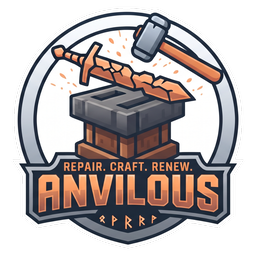

# Anvilous

Repair, combine and enchant your gear at the **smithing table**, with materials and amounts a
datapack decides — and leave the anvil's experience bill behind.

**Minecraft 1.21.1 · NeoForge · client and server**

---

## What it does

Put a damaged tool in the smithing table's base slot and a material in the addition slot.
A recipe says which materials that tool accepts and how much durability each one gives, as a
percentage of the item's maximum. The repaired tool comes out the other side with every
enchantment and component untouched, and it costs no experience — only the material.

The anvil can already do some of this, badly. It charges levels, it raises the price every
time you use it, and eventually it refuses outright. Anvilous moves the job to a block that
doesn't care.

> **It works out of the box.** Every damageable item in vanilla is covered by the built-in
> recipes below. A pack overrides any of them by shipping a file at the same path.

Both sides need the mod: recipes are synced to every client, and the smithing table filters
its input slots against the client's own recipe list.

## Recipe viewers

Every recipe shows up in **JEI**, **EMI** and **REI**, each through a plugin of its own. None
of them is required, and the jar carries no dependency on any: each plugin class is loaded
only by the viewer that looks for it, so with none installed the mod does not know they exist.

Three plugins rather than one and two bridges, because neither bridge would do. REI's, *REI
Plugin Compatibilities*, is published for 1.16.5 Forge and nothing since. EMI's is a mixin
into JEI, so it only forwards plugins JEI has already loaded — which means it does nothing in
a pack that ships EMI alone, the common case.

What they show is the same in all three, from the same code: the three input slots, the
result, and the price as a stack count on the material slot, so a repair reads as "4 diamonds"
and Sharpness V as "5 lapis" without a sentence. The categories share one set of translation
keys, so the three cannot describe the same recipe differently.

## As an anvil replacement

| Anvil operation | Anvilous |
| --- | --- |
| Repair with material units | `anvilous:smithing_repair` |
| Combine two of the same item | `anvilous:smithing_combine` |
| Apply an enchanted book | `anvilous:smithing_enchant` |
| Rename | **not possible** |

Renaming needs a text field, and the smithing table has none. Adding one would mean shipping
a block and a menu of our own, which is exactly what this mod avoids — everything here runs
in the vanilla smithing table, so it cannot collide with whatever else a pack installs. A
pack replacing the anvil entirely still needs something else for naming.

## Repair recipes

One file per tool or tool group, in `data/<namespace>/recipe/`:

```json
{
  "type": "anvilous:smithing_repair",
  "base": { "tag": "minecraft:pickaxes" },
  "materials": [
    { "tag":  "c:ingots/iron",             "percent": 25 },
    { "item": "minecraft:diamond",         "percent": 50 },
    { "item": "minecraft:netherite_ingot", "percent": 100 }
  ],
  "keep_enchantments": true,
  "repair_cost": "reset"
}
```

### Fields

| Field | Meaning |
| --- | --- |
| `base` | The item being repaired. A `tag` or an `item`. |
| `materials` | A list; each entry is a `tag` **or** an `item`, with its own `percent`. Tags and items can be mixed freely in one recipe. |
| `percent` | Durability restored **per material item**, as a percentage of the tool's maximum. A diamond pickaxe (1561) at 100 damage, repaired with a 25% material, gets 391 back. Flat, predictable, independent of how damaged the tool is. |
| `max_per_craft` | *Optional.* The most material items one craft may take. Leave it out and a craft does as much as the materials allow. Set it only to make a full repair take several crafts. |
| `keep_enchantments` | Keeps enchantments and components on the repaired item. Normally `true` — it is the reason this mod exists. |
| `repair_cost` | What to do with the item's hidden anvil-use counter: `reset`, `keep` or `increase`. See below. |
| `template` | *Optional.* An item required in the template slot, if a pack wants the repair gated behind something. Omit it and the slot stays empty. |

### On tags

Prefer a tag to an item wherever one exists. Modded materials are unified by tag, so
`c:ingots/brass` covers every mod's brass ingot at once and keeps working when a pack swaps
which mod provides it — a recipe keeps its tag rather than resolving it to items, so it picks
up whatever is installed at runtime.

Watch the namespace, though. The `c:` convention covers materials (`c:ingots/iron`,
`c:gems/diamond`) and a handful of tools (`c:tools/bow`, `c:tools/shield`), but the common
tool classes are **vanilla** tags in 1.21.1: `minecraft:pickaxes`, `minecraft:axes`,
`minecraft:shovels`, `minecraft:hoes`, `minecraft:swords`. There is no `c:tools/pickaxes`,
and a recipe naming a tag that does not exist simply never matches — no error, no warning.

### What a repair costs

**Takes what it needs, up to what you gave it.** Drop a stack of diamonds in beside a nearly
broken pickaxe and it comes out full, having spent four; do the same beside a pickaxe one
point from full and it spends one. There is no waste and no setting to tune, because the
slot is already the player's own limit — they decide what a craft may spend by deciding what
to put in it.

Vanilla's smithing menu removes exactly one item per craft, so taking the right number needs
a mixin on `SmithingMenu`; it is in `nl.ljack2k.anvilous.mixin`.

## Combine recipes

Two of the same item, their durability added and their enchantments merged — the anvil's
third trick, and the one that needs no material at all:

```json
{
  "type": "anvilous:smithing_combine",
  "base": { "item": "minecraft:bow" },
  "repair_cost": "reset"
}
```

Tool in the base slot, the sacrifice in the addition slot.

This is not the poor relation of material repair, and treating it as one is a mistake worth
not repeating. It is the route you have when you own the item and not the material: a damaged
pickaxe out of a chest, long before there is any ore to mend it with. It is also the only way
to merge the enchantments of two tools, which no amount of material can do. For nine vanilla
items — bows, crossbows, fishing rods, shears, tridents, flint and steel, brushes and the two
sticks-on-a-string — it is the only repair there is, because they have no material at all.

The durability sum is vanilla's, bonus included: both items' remaining durability plus 12% of
the maximum. `bonus_percent` changes that for packs that want to; leave it out for parity.

Enchantments on the sacrifice are merged in by the same rules used for books, and ones that
do not fit are skipped rather than failing the craft — again as the anvil does.

## Enchanting recipes

The same table applies an enchantment from a book, paid for in materials rather than
experience:

```json
{
  "type": "anvilous:smithing_enchant",
  "enchantment": "minecraft:mending",
  "base": { "item": "minecraft:diamond_pickaxe" },
  "materials": [
    { "item": "minecraft:diamond", "per_level": 4 }
  ]
}
```

Book in the template slot, tool in the base slot, payment in the addition slot. The book is
consumed, as it is in an anvil.

The recipe names the **enchantment**, not the book. That is what makes per-enchantment
pricing possible: an ingredient matches items and tags but ignores components, so it could
say "an enchanted book" but never "a Mending book". The book is only where the level is read
from, which is also why `per_level` works — a Sharpness recipe at `"per_level": 2` charges 2
ingots for Sharpness I and 10 for Sharpness V.

| Field | Meaning |
| --- | --- |
| `enchantment` | The enchantment this recipe prices, by id. |
| `base` | What it may be applied to. A `tag` or an `item`. |
| `materials` | Each entry is a `tag` **or** an `item`, with its own `per_level`. |
| `per_level` | Items charged **per level** of the enchantment on the book. |
| `repair_cost` | As for repair: `reset`, `keep` or `increase`. |

Combining follows vanilla's anvil rules, reusing vanilla's own helpers: two equal levels make
the next one up, levels cap at the enchantment's maximum, incompatible enchantments refuse,
and whether an item accepts an enchantment is asked of the item, so modded tools answer for
themselves. A craft that would change nothing is refused rather than charged for.

### `repair_cost`

Every item carries a hidden counter of how many times it has been through an anvil. The anvil
charges it, doubles it (`0 → 1 → 3 → 7 → 15 → 31`), and eventually says *Too Expensive!*.
The smithing table never reads it, so repairs here stay cheap no matter what it says.

- `reset` *(default)* — set it back to zero. The tool comes out clean for any later anvil use.
- `keep` — leave it alone.
- `increase` — grow it the way the anvil would, for packs that want repairs to get costlier.

## Built-in recipes

Anvilous ships 169 recipes, covering every damageable item and every enchantment in vanilla.
None of them are a new balance. Every number in them was read out of the game rather than
decided by us, so what they do is move vanilla's own prices to a block that does not charge
experience and does not get more expensive the more you use it.

A pack replaces any of them by shipping a file at the same path: `data/anvilous/recipe/diamond_pickaxe.json`
in a datapack wins over the built-in copy. It needs no thought about load order — the three
sets are built-in datapacks sitting at the bottom of the stack, so anything else beats them.

Both sets come out of generators in the dev harness — `/anvilous dump_repair <percent>` and
`/anvilous dump_enchant` — so a pack with its own tiers regenerates them rather than editing
a hundred files, and run inside a modpack they cover its modded tools and enchantments too.

### Starting from nothing

The recipes are content; the mod is the engine. The three recipe types, the smithing-table
behaviour and the JEI/EMI/REI plugins all work with none of the built-ins loaded, which is what
a pack with its own progression actually wants — our lapis/amethyst/pearl/powder ladder would
cut straight across whatever tiering it built.

So each set is a datapack that can be switched off, in `config/anvilous-common.toml`:

```toml
[built_in_recipes]
	repair = true
	combine = true
	enchant = false
```

Three switches rather than one, because the three are not equally opinionated. Repair and
combine are vanilla's own numbers read back out of the registry — the material its anvil
already accepts, the quarter it already restores, the pairs it already allows. Enchanting
prices from `anvil_cost` and then picks a material per band, and that second half is a balance
decision we made up. A pack can keep the first two and drop the third.

Ship that file with the modpack and every world its players make starts the way you meant it
to. A single world can drop a set on its own instead, either with
`/datapack disable "mod/anvilous:defaults_enchant"` or from the Datapacks button on the
world-creation screen, where all three are listed by name.

Turning a set off in the config on a world that already had it on leaves one `Missing data pack`
warning in the log, because the world remembers the pack by name. It is harmless, and a world
made after the switch never sees it.

Switching a set off is not the same as overriding its recipes one at a time. There is no way to
delete a recipe from JSON at all — that is the whole reason the switches exist.

### Repair and combining — 127 recipes

A `smithing_combine` for **every** damageable item, 68 of them, and 59 `smithing_repair` for
the ones that have a material. Vanilla's anvil combines any two of the same damageable item —
`AnvilMenu` asks nothing but "same item, damageable?" — so anything less is not an anvil
replacement.

Each repair names the material `Item#isValidRepairItem` already accepts for that item, at
`percent: 25` — the same quarter of maximum durability an anvil restores per unit — and uses
a `c:` tag wherever one exists, so a mod's own iron or leather works too.

### Enchanting — 42 recipes

Vanilla prices enchanting in experience, which looks at first like there is nothing to
translate. But it does carry a number meant for exactly this job: `anvil_cost`, the levels an
anvil bills per level of the enchantment, halved when the source is a book. So that is the
price, one material item per experience level vanilla would have taken.

`anvil_cost` also sorts every vanilla enchantment into four bands, and that sorting is the
game's own opinion about which enchantments are precious — Sharpness sits with Protection
because vanilla put it there, not because we agreed with each other about it. Each band is
paid in its own material:

| `anvil_cost` | Material | Per level | For example |
| --- | --- | --- | --- |
| 1 | `c:gems/lapis` | 1 | Sharpness, Protection, Efficiency, Power, Piercing |
| 2 | `c:gems/amethyst` | 1 | Unbreaking, Smite, Feather Falling, Loyalty |
| 4 | `c:ender_pearls` | 2 | Mending, Fortune, Looting, Fire Aspect, Riptide |
| 8 | `minecraft:blaze_powder` | 4 | Silk Touch, Infinity, Thorns, Channeling, the curses |

So Sharpness V costs 5 lapis, Unbreaking III costs 3 amethyst, Mending costs 2 ender pearls,
and Thorns III costs 12 blaze powder — the same 12 levels an anvil would have charged. Blaze
powder is the one entry written as a plain item: nothing in `c:` names it in 1.21.1, and a
tag that does not exist matches nothing at all rather than complaining.

What each may be applied to is the enchantment's own `supported_items`, so Depth Strider
lands on boots and Breach on maces without anyone listing them.

One rough edge: a book carrying two enchantments matches both their recipes, and the table
picks whichever vanilla found first. Splitting such a book is not something a pack can
express yet.

## Building

`gradlew build` produces the jar under `neoforge/build/libs/`.

To have each build land in launcher instances as well, create a `local.properties`
next to `settings.gradle` (it is gitignored) with their game directories, comma-separated:

```properties
prism_instance=C:/Users/you/.../instances/Anvilous Dev/minecraft, C:/Users/you/.../instances/1.21.1 JEI/minecraft
```

`build` then runs `installToPrism`, which clears out older `Anvilous-*.jar` files and copies
the new one into every instance listed — a bare one for the mod on its own, a modpack-like
one for whether tags pick up other mods' materials, one per recipe viewer. Each also gets its
own task (`installToPrismAnvilousDev` and so on) for refreshing just that one. Without the
property none of them is registered, so the build is unchanged.

A jar in only one instance while the others go stale is worse than no jar at all: it still
looks like a test.

### Running a viewer

The dev runs start with JEI. `-Precipe_viewer=` picks another — `emi`, `rei`, or `both` for
JEI and EMI together:

```
gradlew :neoforge:runClientJoin -Precipe_viewer=rei
```

Only the dev classpath changes; the published jar is the same either way. Inside the dev
client, `/anvilous browse <category>` and `/anvilous browse_item <item>` open whichever viewer
is installed, which is how the categories get screenshotted without anyone touching the mouse.

## License

MIT
